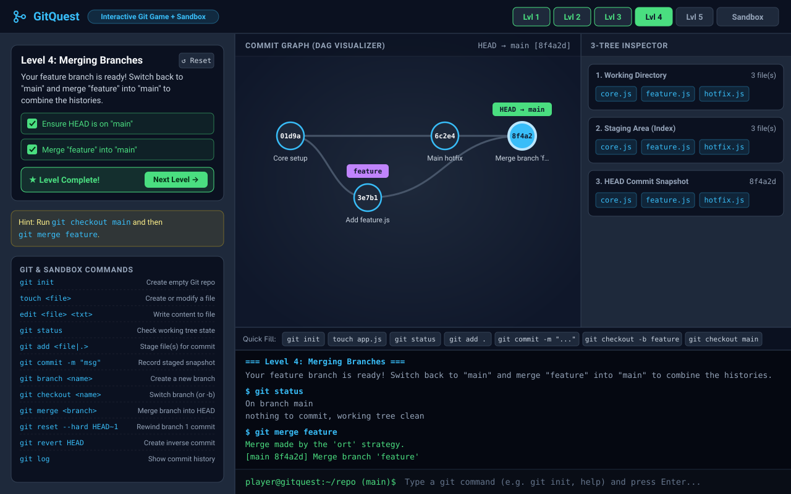
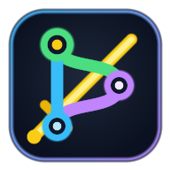

# ⚔️ GitQuest: Master the Art of Version Control

> *"It's dangerous to code alone! Take `git init`."*

Welcome to **GitQuest** — a lightweight, zero-dependency interactive game and visual sandbox that turns learning Git from a scary terminal chore into a hands-on adventure.

Whether you've ever panicked over a detached `HEAD`, wondered where staged files actually live, or wanted a safe place to test `git reset --hard` without nuking your real project, **GitQuest** has your back!



---

## ✨ What's Inside?

* 🎮 **9 Story-Driven Levels + Free-Play Sandbox** — Progress from initializing your first repository to `git switch`, 3-way merge conflicts, `git rebase`, `git reflog` recovery, and repairing corrupted Git repositories.
* 🕸️ **Live Commit DAG Visualizer** — Watch commits, parent pointers, branches (`main`, `feature`), tags, detached `HEAD`, and dangling commits animate in real time as you type commands.
* 📦 **3-Tree State Inspector** — See files move step-by-step across the **Working Directory** (with conflict warnings), **Staging Area (Index)**, and **HEAD Commit Snapshot**.
* 💻 **Built-In Terminal + Context-Aware Quick-Action Buttons** — Type real commands (`git switch`, `git add`, `git commit`, `git merge`, `git rebase`, `git reflog`, `git fsck`, `git stash`) with command history (`↑`/`↓`) or tap level-tailored quick-fill buttons.
* 📱 **Mobile-Ready & Android APK Included** — Responsive mobile UI with touch-friendly controls, view switcher tabs, and a standalone Android APK (`gitquest-android.apk`) targeting Android 15 (API 35).
* ⚡ **Zero Dependencies** — Runs out of the box with pure Node.js (`http`, `fs`, `path`) or directly in any modern browser.

---

## 🚀 Quick Start

No `npm install` bloat required! Just clone or open this folder and run:

```bash
npm start
# or directly with Node:
node server.js
```

Then open **[http://localhost:3000](http://localhost:3000)** in your browser and start playing!

*(Tip: You can also set a custom port with `PORT=8080 npm start` or open `public/index.html` directly in your browser.)*

---

## 📱 Android App: Build & Install the APK

<p align="left">
  
</p>

GitQuest includes a custom **GitQuest** launcher icon (`@drawable/ic_launcher`), a pre-built Android package (`gitquest-android.apk`), and a self-contained build pipeline targeting **Android 15 (API 35, `minSdkVersion 24`)**.

### 🔨 How to Build the Android APK

#### Option 1: Zero-Dependency Python Builder (Fastest)
You can build and sign `gitquest-android.apk` directly using Python 3 and OpenSSL (no Android SDK or Gradle download required):

```bash
npm run build:apk
# or run the builder script directly:
python3 scripts/build_apk.py
```

What this does:
1. Syncs the latest `public/index.html` into `android/app/src/main/assets/index.html`.
2. Generates the custom 192×192 **GitQuest** app icon (`public/icon.png` and `android/app/src/main/res/drawable/ic_launcher.png`).
3. Compiles the binary `AndroidManifest.xml`, 4-byte aligned `resources.arsc` (`0x7f010000` → `@drawable/ic_launcher`), and Dalvik bytecode `classes.dex` (`com.gitquest.app.MainActivity`).
4. Signs the package with both **JAR Signature (v1)** and **APK Signature Scheme v2** (`APK Sig Block 42`) and outputs `gitquest-android.apk` in the project root.

#### Option 2: Android Studio / Gradle
A standard Android Gradle project is also included in the `android/` directory:
1. Open the `android/` folder in **Android Studio**.
2. Let Gradle sync, then select **Build → Build Bundle(s) / APK(s) → Build APK(s)** (or run `./gradlew assembleDebug` from `android/`).

---

### 📲 How to Install the APK on Your Android Phone

#### Method 1: Direct File Transfer (No Computer Tools Needed)
1. Copy `gitquest-android.apk` to your Android phone via **USB file transfer**, **Google Drive**, **Quick Share**, or **Bluetooth**.
2. On your phone, open the **Files** (or **My Files**) app and tap `gitquest-android.apk`.
3. If prompted with *"For your security, your phone currently isn't allowed to install unknown apps from this source"*, tap **Settings** and toggle **Allow from this source** on.
4. Tap **Install**, then tap **Open** to launch **GitQuest**!
5. *(Note)*: Because the APK is signed with a local debug certificate, if **Google Play Protect** asks *"Scan app?"* or *"Install anyway?"*, tap **More details → Install anyway**.

#### Method 2: Install via ADB (Android Debug Bridge)
1. On your Android phone, enable **Developer Options** (*Settings → About phone → tap **Build number** 7 times*).
2. Go to *Settings → System → Developer options* and enable **USB debugging**.
3. Connect your phone to your computer via USB and run:
   ```bash
   adb install -r gitquest-android.apk
   ```
4. Launch **GitQuest** from your phone's app drawer!

---

## 🗺️ The Campaign (Levels)

| Level | Mission Name | Skills Unlocked |
| :--- | :--- | :--- |
| **Level 1** | **Wake Up, Git!** | Initialize a repo (`git init`), create files (`touch`), and stage changes (`git add`). |
| **Level 2** | **First Snapshot** | Permanently record snapshots into the commit history (`git commit -m "..."`). |
| **Level 3** | **Branching Out (`git switch`)** | Create and switch to isolated feature branches (`git switch -c feature`). |
| **Level 4** | **Merging Branches** | Switch back (`git switch main`) and combine divergent histories (`git merge feature`). |
| **Level 5** | **Oops! Undo Commit** | Rescue `main` from a bad commit using `git revert HEAD` or `git reset --hard HEAD~1`. |
| **Level 6** | **Clash of Code (Merge Conflict)** | Trigger a 3-way merge conflict, inspect markers (`cat`), resolve (`edit` or `--ours`/`--theirs`), stage, and commit. |
| **Level 7** | **Linear History (`git rebase`)** | Replay feature commits cleanly onto `main` (`git rebase main`) and fast-forward merge. |
| **Level 8** | **Lost Commit Rescue (Reflog)** | Recover a hard-reset orphaned commit using `git reflog` / `git fsck` and `git reset --hard HEAD@{1}`. |
| **Level 9** | **Corrupted Repo Emergency** | Diagnose corruption (`git fsck`), remove `.git/index.lock`, rebuild a corrupted `.git/index`, reattach `HEAD`, and roll back `main`. |
| **🛠️ Sandbox** | **Free-Play Mode** | An open playground to experiment with branches, conflicts, rebases, stashes, tags, reflogs, and more! |

---

## 🧰 Supported Sandbox Commands

Inside the GitQuest terminal, you can mix and match shell commands and Git commands:

```bash
# File & Directory Commands
ls                               # List files in the working directory
touch <file>                     # Create or update a file
edit <file> <text>               # Write custom text into a file (or resolve conflicts)
cat <file>                       # View file contents (including conflict markers)
rm <file>                        # Remove a file (or rm .git/index.lock / rm .git/index)
clear                            # Clear terminal output
help                             # Show all available commands

# Git Commands
git init                         # Initialize the repository
git status                       # Inspect untracked, modified, staged, and conflicted files
git diff [--staged]              # View working tree or staged diffs
git add <file | .>               # Stage file(s) or mark conflicted file as resolved
git restore [--staged] <file|.>  # Discard working changes or unstage file(s)
git commit -m "message"          # Create a new commit snapshot
git switch [-c] <branch>         # Switch branches (or create & switch with -c)
git switch -                     # Switch back to previous branch
git checkout [-b] <branch|ref>   # Switch branches or detach HEAD at commit
git checkout --ours/--theirs <f> # Resolve merge conflict keeping ours or theirs
git branch [-d] [name] [ref]     # List, create, or delete branches
git merge <branch> [--abort]     # Merge target branch into HEAD (with conflict detection)
git rebase <branch>              # Replay current branch commits onto target branch
git cherry-pick <commit>         # Apply a specific commit onto the current branch
git stash [pop|apply|list|drop]  # Stash and restore dirty working tree changes
git tag [name]                   # List or create tags at HEAD
git reset [--hard|--soft] <ref>  # Move current branch pointer to ref (HEAD~N, HEAD@{N}, hash)
git revert <ref>                 # Create a new commit that undoes target commit
git log [--oneline]              # View commit history, branches, and tags
git reflog                       # View HEAD movement history to recover lost commits
git fsck                         # Verify object database integrity & detect corruption
```

---

## 📂 Project Structure

```text
.
├── package.json          # Scripts (`npm start`, `npm run dev`, `npm run build:apk`)
├── server.js             # Lightweight Node.js static server
├── gitquest-android.apk  # Ready-to-install signed Android APK (API 35)
├── scripts/
│   └── build_apk.py      # Zero-dependency Android APK compiler & v1/v2 signer
├── android/              # Android Studio / Gradle project wrapper
│   ├── build.gradle
│   ├── settings.gradle
│   └── app/
│       ├── build.gradle
│       └── src/main/
│           ├── AndroidManifest.xml
│           ├── assets/index.html
│           ├── res/drawable/ic_launcher.png
│           └── java/com/gitquest/app/MainActivity.java
├── public/
│   ├── index.html        # Mobile-responsive Game UI, SVG DAG graph, and GitSandbox engine
│   ├── icon.png          # Custom GitQuest app & launcher icon
│   ├── screenshot.png    # Application screenshot
│   └── screenshot.svg    # Vector source for the application screenshot
└── README.md             # You are here!
```

---

## 🏆 Pro Tips for Players

1. **Watch the 3-Tree Inspector on the right**: Notice how `touch app.js` puts a red pill in **Working Directory**, `git add app.js` copies it into **Staging Area**, and `git commit` locks it into the **HEAD Commit Snapshot**.
2. **Compare `reset` vs `revert` in Level 5**:
   * `git reset --hard HEAD~1` rewinds the branch pointer backwards.
   * `git revert HEAD` keeps history intact and adds a brand-new commit that undoes the changes.
3. **Stuck?** Click the **↺ Reset** button at the top of the mission card anytime to start the current level fresh.

Happy branching! 🌿
